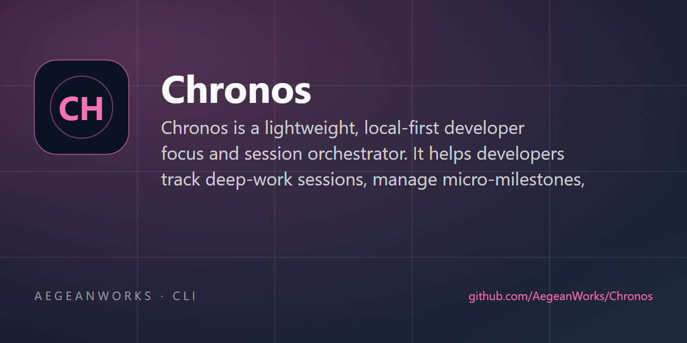

# chronos

<!-- aegean:media:start -->
<p align="center"></p>
<p align="center"><a href="LICENSE"></a> <a href="https://github.com/AegeanWorks/AIKit"></a></p>
<!-- aegean:media:end -->


Chronos is a lightweight, local-first developer focus and session orchestrator. It helps developers track deep-work sessions, manage micro-milestones, log interruptions, and generate productivity insights with zero external dependencies.

## ⚡ 30-Second Cold-Start Quick Reference

- **Runtime Prerequisites**: Python 3.10+ (standard library only; zero third-party packages required).
- **Canonical Regression Shield Gate**:
  ```bash
  python aikit.py check chronos
  ```

### 🛠️ AIKit Commands (run from the AIKit folder)
| Role | Command |
|---|---|
| Status, task and gates | `python aikit.py status chronos` |
| Phase 4: every gate | `python aikit.py check chronos` |
| Repair memory and map, then check | `python aikit.py fix chronos` |
| Resume an interrupted task | `python aikit.py resume chronos` |

## 📦 What's Inside

```text
chronos/
├── .aikit/                   <- this project's memory: record, ledger, decisions
├── .gitignore                <- transient AIKit state excluded
├── README.md
├── assets/
├── COMMERCIAL.md
├── pyproject.toml            <- build and package configuration
├── chronos/                  <- core package source code
├── LICENSE
├── LICENSES/                 <- REUSE license texts
├── REUSE.toml                <- Machine-readable SPDX metadata
└── tests/                    <- unit and integration test suite
```

## 🚀 CLI Usage & Quick Start

Chronos requires only Python 3.10+ with standard library modules.

### 1. Starting and Managing Focus Sessions

```bash
# Start a 25-minute focus session
python -m chronos.cli start "Refactor storage layer" --duration 25 --tag coding

# Check live session progress and status
python -m chronos.cli status

# Pause during an interruption or meeting
python -m chronos.cli pause

# Resume focus
python -m chronos.cli resume

# Log an interruption with cause and a non-negative duration
python -m chronos.cli interrupt "Urgent Slack message" --duration 120

# Finish and log session notes
python -m chronos.cli finish --notes "Completed atomic tempfile writes"

# Print the installed CLI version
python -m chronos.cli --version
```

`start --task <id>` fails loudly when the task does not exist, so a typo can never
silently create an unbound session. Session titles must be non-empty and durations
must be positive.

### 2. Micro-Milestones & Tasks

```bash
# Add a micro-milestone
python -m chronos.cli task add "Implement test suite" --estimate 30

# List active and completed tasks (or filter by --status, or export --json)
python -m chronos.cli task list
python -m chronos.cli task list --status pending
python -m chronos.cli task list --json

# Inspect task progress, estimate, spent time, and linked focus sessions
python -m chronos.cli task show <task_id>
python -m chronos.cli task show <task_id> --json

# Mark task complete
python -m chronos.cli task done <task_id>

# Remove an unneeded task (prevented if currently bound to an active session)
python -m chronos.cli task remove <task_id>

# Clear all completed tasks from the backlog
python -m chronos.cli task clear
```

### 3. Productivity Insights & Streaks

```bash
# View summary metrics for the past 7 days (streak spans full history);
# includes total focus, interruption count, and interruption minutes
python -m chronos.cli stats

# Export metrics as JSON for integration
python -m chronos.cli stats --json
```

### 4. Reviewing Session History

```bash
# List the 20 most recent archived sessions, newest first
python -m chronos.cli history

# Only sessions started within the last 7 days, for one tag
python -m chronos.cli history --days 7 --tag coding

# Export the archived session list as JSON for integration
python -m chronos.cli history --json
```

`--limit` caps the list (default 20) and `--tag` matches case-insensitively. Rows whose
stored start timestamp is malformed or in the future are skipped, exactly like the
stats window.

## 🛡️ Architecture & Guarantees

- **Zero Undeclared Dependencies**: Built exclusively on Python 3 standard library (`argparse`, `json`, `pathlib`, `dataclasses`, `datetime`).
- **Crash Resilience**: State writes use atomic temp files with `fsync`, atomic `os.replace`, and a POSIX directory flush to prevent corrupted state on sudden termination.
- **Idempotent Lifecycle**: a stale `completed`/`aborted` active record left by a crash is ignored, so repeating `finish` or `abort` cannot credit a bound task twice.
- **Resilient Console & State**: redirected or legacy-encoding terminals degrade gracefully instead of crashing, and unreadable or hand-edited state files are quarantined (with collision-free names) and recovered from the atomic backup. Concurrent CLI commands serialize on one advisory data-directory lock, so read-modify-write updates cannot be lost.
- **Fast Test Suite**: 100% test pass rate in <1 second with `python -m unittest discover`.

<!-- aegean:brand-assets:start -->
## 🎨 Brand Assets

> **AI-Generated Brand Artwork.** The banner and logo are **AI-generated brand assets**. They are illustrative and may not literally depict every feature or the full project scope.
<!-- aegean:brand-assets:end -->

## 📜 License

Free for personal use under the Aegean License 1.1 (AL-1.1); see [LICENSE](LICENSE). Any commercial use needs the Aegean Commercial License 1.0 (ACL-1.0); see [COMMERCIAL.md](COMMERCIAL.md).
